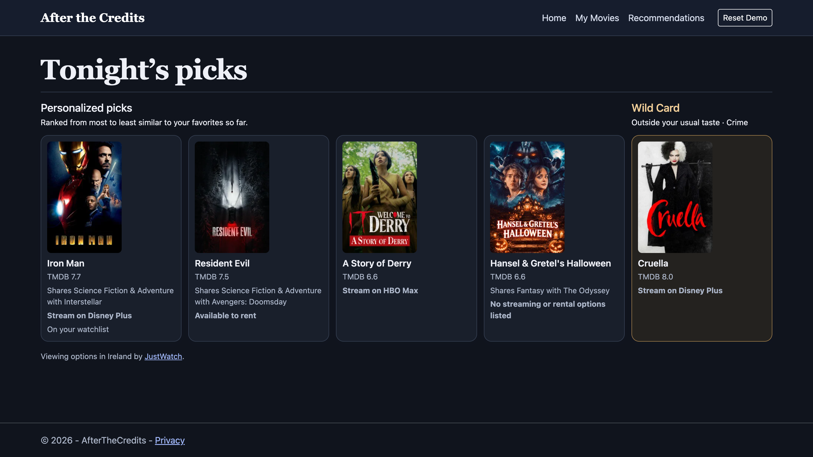
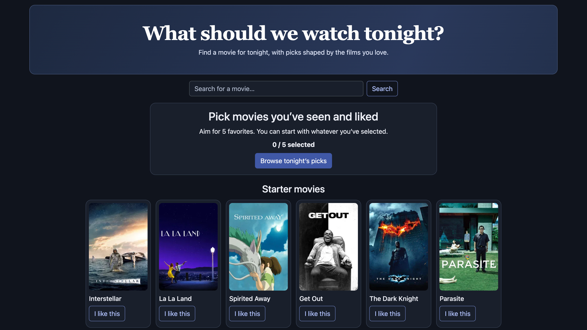
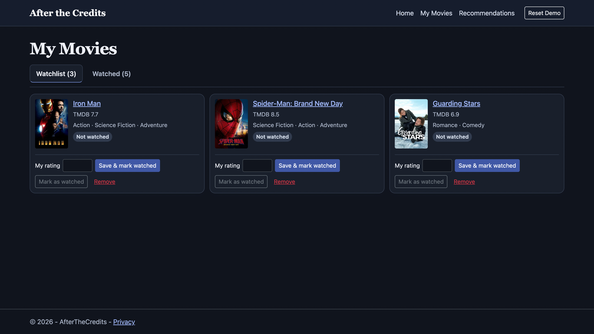
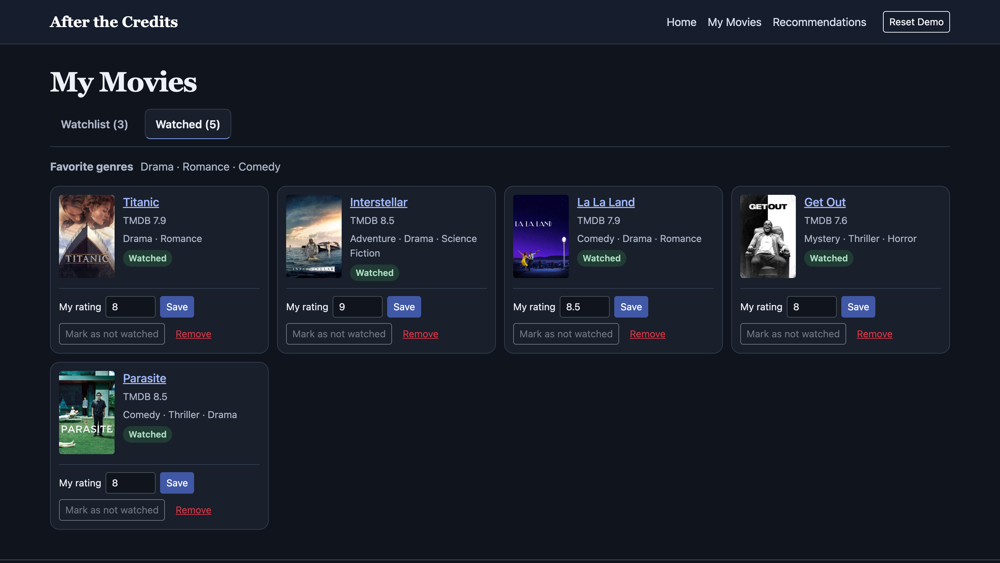

# After the Credits

**Spend less time choosing a movie and more time watching one.**

[Private live demo](https://afterthecredits-production.up.railway.app/) · Hosted on Railway · Access password shared with invited adult reviewers

After the Credits is a full-stack movie discovery web application. Instead of presenting an endless feed, it aims to offer four personalized movie picks and one Wild Card that explores a genre the viewer rarely watches. Each pick includes viewing availability in Ireland when that information is available.



## Features

- **Cold-start onboarding:** Aim to select five movies you have seen and liked from a curated starter collection, or find favorites through search. You can also start with fewer movies or skip onboarding and browse popular picks.
- **Personalized recommendations:** Gemini text embeddings capture movie titles, genres and plot summaries. Cosine similarity ranks unseen candidates against the viewer's highly rated movies.
- **Wild Card:** Discover a well-rated movie from an underrepresented genre in the viewer's watch history.
- **My Movies:** Manage separate Watchlist and Watched views. Rating a movie automatically marks it as watched and excludes it from future recommendations.
- **Viewing availability:** See subscription and rental options in Ireland, when provided by TMDB.
- **Anonymous demo sessions:** No account is required. Each visitor's ratings and watch history are isolated, expire after 24 hours, and can be cleared with Reset Demo.

## User experience

### Cold-start onboarding

Choose films you have seen and enjoyed to help establish your preferences.



<details>
<summary>My Movies — Watchlist and Watched</summary>

Save films for later in Watchlist, and record watched films and personal ratings.





</details>

## How recommendations work

1. Build a candidate pool from popular TMDB movies and unwatched movies from the visitor's watchlist. Exclude watched movies and deduplicate by TMDB ID.
2. Generate 768-dimensional Gemini embeddings for each movie's structured text. Store them in SQLite so identical inputs can reuse cached vectors.
3. Compare each candidate with up to five watched movies rated 8/10 or higher and rank by mean cosine similarity. Display up to four personalized picks, with shared genres shown where applicable.
4. Build a separate Wild Card pool from genres appearing in at most 20% of the viewer's known watch history. Require a TMDB rating of at least 7/10 and at least 100 votes, and exclude watched movies and the personalized picks.
5. Retrieve streaming and rental availability for the selected movies. If personalization is unavailable, show a short list of popular picks.

## Tech stack

| Layer | Technology |
| --- | --- |
| Web application | C#, .NET 10, ASP.NET Core Razor Pages |
| UI | HTML, CSS, Bootstrap, JavaScript |
| Data | SQLite, Entity Framework Core |
| Movie metadata | TMDB API |
| Semantic recommendations | Gemini Embedding 2 |
| Access and session isolation | ASP.NET Core Cookie Authentication, Authorization, Data Protection |

The shared access password is configured on the server. A separate seven-day authentication cookie grants access to the demo, while a 24-hour visitor cookie links each browser to its own movie records. Watchlists, ratings and visitor session expiry are stored in SQLite, while embeddings generated from public movie metadata are shared across sessions.

## Run locally

Prerequisites: .NET 10 SDK, a trusted local HTTPS development certificate, a TMDB read access token, and a Gemini API key.

```bash
git clone https://github.com/captainxixi/AfterTheCredits.git
cd AfterTheCredits
dotnet user-secrets set "TMDB:ReadAccessToken" "YOUR_TMDB_READ_ACCESS_TOKEN"
dotnet user-secrets set "Gemini:ApiKey" "YOUR_GEMINI_API_KEY"
dotnet user-secrets set "DemoAccess" "YOUR_PRIVATE_DEMO_PASSWORD"
dotnet run --launch-profile https
```

Open [https://localhost:7103](https://localhost:7103). EF Core applies database migrations automatically at startup. API credentials, the access password and the local SQLite database are excluded from version control.

## Deployment

For a single-instance deployment, configure the following environment variables:

| Variable | Purpose |
| --- | --- |
| `DemoAccess` | Shared private demo password. Access is denied if it is unset. |
| `TMDB__ReadAccessToken` | TMDB API authentication |
| `Gemini__ApiKey` | Gemini API authentication |
| `ConnectionStrings__DefaultConnection` | SQLite connection string pointing to a persistent disk, with foreign keys enabled |
| `DataProtection__KeysPath` | Persistent directory for cookie protection keys |

Persist both the SQLite database and data protection keys across restarts. The application can initialize a fresh database on first startup.

## Data sources

Movie data and posters are provided by [The Movie Database (TMDB)](https://www.themoviedb.org/). Streaming availability is provided by [JustWatch](https://www.justwatch.com/ie) through TMDB.

This application uses the TMDB API but is not endorsed or certified by TMDB.
